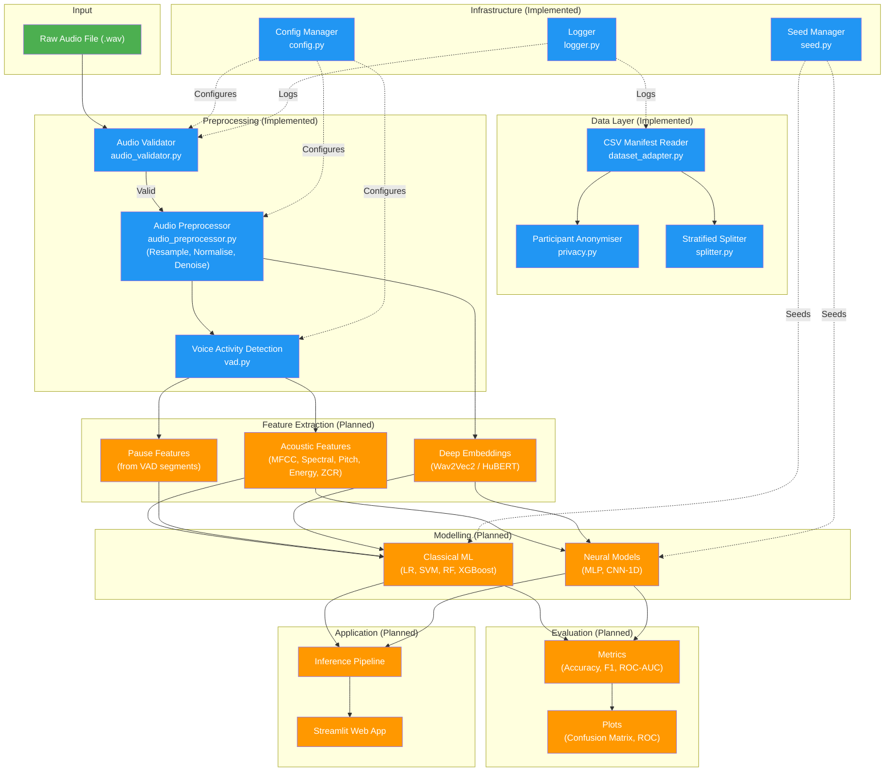

# DementiaVoiceAI

## AI-Based Alzheimer's Disease Detection Using Speech

### Project Phase 2 — Progress Report

---

| Field | Details |
|---|---|
| **Project Title** | DementiaVoiceAI — AI-Based Alzheimer's Disease Detection Using Speech |
| **Document Title** | Project Phase 2 Progress Report |
| **Student Names** | Kashyap Manish (26MAG0047), Pravin Kumar (26MAG0012) |
| **Programme** | M.Sc. AIML |
| **Institution** | VIT Vellore University |
| **Faculty Guide** | Dr. Durai Raj Vincent P.M |
| **Submission Phase** | Phase 2 |
| **Date** | 14 October 2026 |

---

## Table of Contents

1. [Abstract](#1-abstract)
2. [Introduction](#2-introduction)
3. [Problem Statement](#3-problem-statement)
4. [Objectives](#4-objectives)
5. [Project Scope and Expected Outcomes](#5-project-scope-and-expected-outcomes)
6. [Existing System and Proposed Solution](#6-existing-system-and-proposed-solution)
7. [System Architecture](#7-system-architecture)
8. [Technology Stack](#8-technology-stack)
9. [Dataset Description](#9-dataset-description)
10. [Methodology and ML Pipeline](#10-methodology-and-ml-pipeline)
11. [Model Development and Implementation](#11-model-development-and-implementation)
12. [Work Completed During Phase 2](#12-work-completed-during-phase-2)
13. [Current Project Progress](#13-current-project-progress)
14. [Preliminary Results and Evaluation](#14-preliminary-results-and-evaluation)
15. [Testing and Validation](#15-testing-and-validation)
16. [Challenges Faced and Solutions](#16-challenges-faced-and-solutions)
17. [Current Limitations](#17-current-limitations)
18. [Project Timeline and Milestones](#18-project-timeline-and-milestones)
19. [Remaining Work and Future Implementation Plan](#19-remaining-work-and-future-implementation-plan)
20. [Expected Final Deliverables](#20-expected-final-deliverables)
21. [Conclusion](#21-conclusion)
22. [References](#22-references)
23. [Appendices](#23-appendices)

---

## 1. Abstract

Alzheimer's disease and related dementias represent a growing global health challenge, with early detection being critical for effective management and care planning. This project, **DementiaVoiceAI**, proposes an end-to-end machine learning system that analyses speech recordings to identify acoustic patterns associated with cognitive impairment. The system takes WAV audio recordings as input, processes them through a standardised preprocessing pipeline (resampling, normalisation, voice activity detection), extracts acoustic features, and applies trained binary classifiers to distinguish between speakers diagnosed with dementia and cognitively healthy control speakers.

The technology stack is built upon Python 3.12+, leveraging librosa for audio processing, scikit-learn and XGBoost for classical ML models, and PyTorch with Hugging Face Transformers for planned deep-learning embeddings. A Streamlit web application is planned for interactive demonstration.

As of Phase 2, the project has completed its foundational infrastructure: project scaffolding, YAML-based centralised configuration, structured logging, reproducibility seeding, privacy-safe participant anonymisation, a dataset adapter for loading and validating the celebrity speech dataset (275 recordings from 141 speakers), a participant-level stratified data splitter with leakage prevention, audio validation, audio preprocessing (resampling, normalisation, noise reduction), energy-based voice activity detection, and initial unit tests. Acoustic feature extraction, model training, evaluation, inference pipeline, and the Streamlit UI remain as planned work for subsequent phases.

No model has been trained and no experimental accuracy results are available yet. The expected final outcome is a working binary classifier with confidence scores, delivered via a web-based demo, accompanied by a full evaluation report.

---

## 2. Introduction

### 2.1 Background

Alzheimer's disease (AD) is the most common form of dementia, a progressive neurodegenerative disorder that impairs memory, thinking, and behaviour. According to the World Health Organization, over 55 million people worldwide live with dementia, and approximately 10 million new cases arise each year. Early detection is crucial because it allows patients and families to plan care, access treatment options that may slow progression, and participate in clinical trials.

### 2.2 Speech as a Biomarker

A growing body of research indicates that speech and language patterns change in measurable ways during the early stages of cognitive decline. Individuals with Alzheimer's disease often exhibit:

- **Acoustic changes**: Reduced pitch variability, increased pause frequency and duration, altered speech rate, and changes in vocal quality (jitter, shimmer).
- **Linguistic changes**: Simplified vocabulary, increased word-finding difficulties, reduced syntactic complexity, and greater use of filler words.

These changes make speech a promising non-invasive biomarker for cognitive impairment screening.

### 2.3 Limitations of Existing Approaches

Traditional cognitive screening methods (e.g., Mini-Mental State Examination, Montreal Cognitive Assessment) require in-person clinical administration, are susceptible to education and cultural bias, and may miss subtle early changes. While several research efforts have explored speech-based dementia detection, many rely on clinical datasets (e.g., DementiaBank Pitt Corpus) with limited diversity, require manual transcription, or use complex architectures that are difficult to deploy outside research settings.

### 2.4 Motivation

This project is motivated by the need for an accessible, automated, and non-invasive screening tool that can analyse speech recordings without requiring specialised clinical equipment. By building an end-to-end system that processes raw audio and produces a classification with a confidence score, the project aims to demonstrate the feasibility of ML-based cognitive impairment screening from speech — within the scope of an academic research project.

> **Disclaimer:** This is an academic AI/ML research project. It is **NOT** a medical diagnostic tool and does not claim to diagnose Alzheimer's disease.

---

## 3. Problem Statement

### 3.1 Problem Definition

The project aims to build a binary classification system that, given a speech recording of a person, predicts whether the speaker shows patterns associated with **cognitive impairment (dementia)** or falls within the **control (healthy)** category.

### 3.2 Target Users

The intended users of the final system are:

- Researchers studying speech-based biomarkers for dementia.
- Academic evaluators reviewing the project.
- Potentially, healthcare screening programmes (in a future, clinically validated iteration beyond the scope of this project).

### 3.3 Current Difficulties

- **Access to clinical data**: High-quality, labelled dementia speech datasets are scarce and access-restricted. The project uses a publicly collected celebrity speech dataset as an alternative.
- **Variability in recordings**: The dataset contains recordings from diverse sources (interviews, public appearances) with varying audio quality, recording environments, and microphone setups.
- **Class imbalance**: The dataset exhibits a moderate class imbalance between dementia and control groups.
- **Privacy concerns**: Since recordings involve real individuals, the system must handle personally identifiable information carefully.

### 3.4 Why an ML-Based Solution

Machine learning is appropriate for this problem because:

- Speech features are high-dimensional and contain subtle patterns that are difficult for humans to consistently quantify.
- ML models can learn discriminative patterns from labelled data and generalise to new, unseen recordings.
- The pipeline can be fully automated, from raw audio to prediction, without manual intervention.

### 3.5 Scope and Boundaries

- **In scope**: Binary classification (dementia vs. control) from audio recordings, acoustic feature extraction, classical ML baselines, a web-based demo.
- **Out of scope**: Clinical diagnosis, multi-class severity staging, real-time processing, deployment to production healthcare systems, linguistic feature extraction from transcripts (planned but dependent on transcript availability).

---

## 4. Objectives

### 4.1 Primary Objectives

| Objective | Status |
|---|---|
| Build an end-to-end ML system for speech-based dementia detection | **In Progress** |
| Achieve binary classification (dementia vs. control) with meaningful accuracy | **Planned** |
| Demonstrate the system via an interactive web application | **Planned** |

### 4.2 Specific Technical Objectives

| Objective | Status |
|---|---|
| Design a modular, well-documented Python project structure | **Completed** |
| Implement centralised YAML-based configuration management | **Completed** |
| Build a privacy-safe dataset adapter with participant anonymisation | **Completed** |
| Implement participant-level stratified data splitting (no leakage) | **Completed** |
| Develop audio validation, preprocessing, and normalisation pipeline | **Completed** |
| Implement energy-based Voice Activity Detection (VAD) | **Completed** |
| Extract acoustic features (MFCCs, spectral, pitch, energy, ZCR, jitter/shimmer, pauses) | **Planned** |
| Extract deep-learning speech embeddings (Wav2Vec2 / HuBERT) | **Planned** |
| Train baseline classifiers (Logistic Regression, SVM, Random Forest, XGBoost) | **Planned** |
| Train neural models (MLP, CNN-1D) | **Planned** |
| Evaluate models with accuracy, precision, recall, F1, ROC-AUC | **Planned** |
| Build an inference pipeline for single-file prediction | **Planned** |
| Develop a Streamlit web application for interactive demo | **Planned** |
| Write unit and integration tests with adequate coverage | **In Progress** |
| Produce a final technical report and presentation | **In Progress** |

### 4.3 Expected Deliverables

- Complete source code with documentation.
- Processed dataset and data manifests.
- Trained model checkpoints with evaluation results.
- Streamlit web application.
- Unit and integration tests.
- Final project report and presentation.

### 4.4 Objectives Achieved by Phase 2

The following objectives have been fully completed as of Phase 2:

1. Project structure and scaffolding.
2. Configuration management system.
3. Logging and reproducibility infrastructure.
4. Privacy and anonymisation utilities.
5. Dataset adapter and manifest loading.
6. Participant-level stratified data splitting.
7. Audio validation module.
8. Audio preprocessing pipeline (resampling, normalisation, noise reduction).
9. Energy-based Voice Activity Detection.
10. Initial unit tests for splitter and VAD.

### 4.5 Objectives Pending

- Acoustic feature extraction.
- Deep-learning embedding extraction.
- Model training and hyperparameter tuning.
- Model evaluation and result generation.
- Inference pipeline.
- Streamlit web application.
- Comprehensive test suite.
- Final documentation and report.

---

## 5. Project Scope and Expected Outcomes

### 5.1 Features Included

| Feature | Current Status |
|---|---|
| Audio loading from local file system | Implemented |
| CSV manifest parsing (TSV format) | Implemented |
| Participant anonymisation | Implemented |
| Audio validation (format, duration, corruption) | Implemented |
| Audio preprocessing (resample, normalise, noise reduction) | Implemented |
| Voice Activity Detection | Implemented |
| Acoustic feature extraction | Planned |
| Deep-learning embeddings (Wav2Vec2/HuBERT) | Planned |
| Classical ML training (LR, SVM, RF, XGBoost) | Planned |
| Neural model training (MLP, CNN-1D) | Planned |
| Evaluation metrics and plots | Planned |
| Inference pipeline | Planned |
| Streamlit web application | Planned |

### 5.2 Features Intentionally Excluded

- Linguistic feature extraction from transcripts (excluded until transcript data is available).
- Multi-class severity staging (e.g., mild, moderate, severe).
- Real-time streaming analysis.
- Cloud deployment or production API.
- Mobile application.

### 5.3 Intended Inputs and Outputs

- **Input**: WAV audio recording of a speaker (up to 10 minutes, minimum 1 second).
- **Output**: Binary classification label (Cognitive Impairment / Control), confidence score, and confidence band (High / Medium / Low).

### 5.4 Expected Academic Contribution

The project aims to demonstrate that acoustic features extracted from publicly available speech recordings can be used to distinguish speakers with known dementia diagnoses from healthy controls, using standard ML classifiers. It provides a reproducible, modular, and privacy-aware framework for speech-based cognitive impairment screening research.

---

## 6. Existing System and Proposed Solution

### 6.1 Existing Approaches

Current clinical methods for detecting cognitive impairment include standardised neuropsychological tests (MMSE, MoCA), brain imaging (MRI, PET), and cerebrospinal fluid biomarker analysis. These methods are expensive, invasive, require clinical expertise, and may detect changes only after significant neurodegeneration has occurred.

Research-based speech analysis systems (e.g., using the DementiaBank Pitt Corpus) have shown promising results but are typically restricted to clinical datasets, require manual transcription, and lack end-to-end automation.

### 6.2 Proposed Solution

DementiaVoiceAI proposes a fully automated pipeline that:

1. Accepts a raw audio file as input.
2. Validates and preprocesses the audio (resampling, normalisation, silence trimming).
3. Extracts a comprehensive set of acoustic features.
4. Passes features through trained classifiers.
5. Returns a prediction with a confidence score.
6. Presents results through an interactive web interface.

### 6.3 Role of ML in the Solution

Machine learning serves as the core decision-making component. Classical ML models (Logistic Regression, SVM, Random Forest, XGBoost) are used as baselines to establish performance benchmarks. Optional deep-learning embeddings (from Wav2Vec2 or HuBERT) are planned to capture richer representations of speech that may improve classification performance.

---

## 7. System Architecture

### 7.1 Architecture Diagram



> **Legend**: Blue = Implemented, Orange = Planned, Green = Input/Output.

### 7.2 Component Descriptions

| Component | File(s) | Description |
|---|---|---|
| **Config Manager** | `src/utils/config.py` | Loads `configs/default.yaml`, provides dot-access (`DotDict`), supports deep merge overrides. Detects project root automatically. |
| **Logger** | `src/utils/logger.py` | Configures dual console + file logging with structured format. Privacy-safe (no raw audio or participant names in logs). |
| **Seed Manager** | `src/utils/seed.py` | Sets random seeds for Python, NumPy, and optionally PyTorch for reproducibility. |
| **Privacy / Anonymiser** | `src/utils/privacy.py` | Maps real speaker names to anonymous IDs (`SPK_001`, `SPK_002`, …). Also provides path scrubbing and text scrubbing utilities. |
| **Dataset Adapter** | `src/data/dataset_adapter.py` | Abstract `DatasetAdapter` interface + concrete `CelebritySpeechAdapter` that reads TSV manifests, extracts speaker names from paths, resolves local audio files, and returns participants and recordings DataFrames. |
| **Splitter** | `src/data/splitter.py` | `ParticipantSplitter` performs stratified splitting at the participant level (not recording level) to prevent data leakage. Supports custom train/val/test ratios. |
| **Audio Validator** | `src/preprocessing/audio_validator.py` | `AudioValidator` checks file existence, format, duration, sample rate, silence, and NaN/Inf. Returns a `ValidationResult` dataclass. Supports batch validation. |
| **Audio Preprocessor** | `src/preprocessing/audio_preprocessor.py` | `AudioPreprocessor` loads audio via librosa, resamples to 16 kHz, converts to mono, removes DC offset, normalises (peak or RMS), and optionally applies spectral gating noise reduction via `noisereduce`. Supports both file-based and in-memory processing. |
| **VAD** | `src/preprocessing/vad.py` | `EnergyVAD` performs frame-level energy-based voice activity detection with smoothing. Returns `VADResult` containing speech/silence segments with timing, speech ratio, pause statistics, and a `trim_silence` utility. |
| **Entry Point** | `main.py` | CLI entry point: `python main.py` verifies setup; `python main.py --validate` runs full dataset validation. |

---

## 8. Technology Stack

| Technology / Tool | Purpose | Actual Usage | Status |
|---|---|---|---|
| **Python 3.12+** | Primary programming language | All source code | In use |
| **NumPy ≥ 1.26** | Numerical computing, array operations | Audio signal processing, VAD energy computation | In use |
| **Pandas ≥ 2.1** | Data manipulation, DataFrames | CSV manifest loading, participant/recording tables | In use |
| **SciPy ≥ 1.11** | Scientific computing | Listed as dependency | Installed, not yet directly used |
| **librosa ≥ 0.10.1** | Audio loading, resampling, trimming | Audio preprocessor, audio validator | In use |
| **soundfile ≥ 0.12.1** | Audio I/O backend for librosa | Backend dependency | Installed |
| **scikit-learn ≥ 1.3** | Classical ML models, evaluation | Listed for planned model training | Installed, not yet used for modelling |
| **XGBoost ≥ 2.0** | Gradient boosting classifier | Listed for planned model training | Installed, not yet used |
| **imbalanced-learn ≥ 0.11** | SMOTE oversampling | Listed in requirements.txt | Installed, not yet used |
| **PyTorch ≥ 2.1** | Deep learning framework | Optional; for neural models | Optional dependency |
| **torchaudio ≥ 2.1** | Audio processing for PyTorch | Optional; for embeddings | Optional dependency |
| **Transformers ≥ 4.35** | Pretrained speech models (Wav2Vec2, HuBERT) | Optional; for embeddings | Optional dependency |
| **Matplotlib ≥ 3.8** | Plotting and visualisation | Listed for planned evaluation plots | Installed, not yet used |
| **Seaborn ≥ 0.13** | Statistical data visualisation | Listed for planned evaluation plots | Installed, not yet used |
| **PyYAML ≥ 6.0.1** | YAML configuration parsing | Config loader | In use |
| **Streamlit ≥ 1.28** | Web application framework | Listed for planned UI | Installed, not yet used |
| **tqdm ≥ 4.66** | Progress bars | Listed as dependency | Installed, not yet directly used |
| **noisereduce** | Spectral gating noise reduction | Optional in audio preprocessor | Optional (commented out in requirements.txt) |
| **pytest ≥ 7.4** | Testing framework | Unit tests for splitter and VAD | In use |
| **pytest-cov ≥ 4.1** | Test coverage reporting | Listed as dev dependency | Installed |
| **Git** | Version control | `.git` initialised (no commits yet) | In use |
| **Hatchling** | Python build system | Declared in `pyproject.toml` | Configured |

---

## 9. Dataset Description

### 9.1 Overview

| Attribute | Details |
|---|---|
| **Dataset Name** | Celebrity Speech Dataset (custom-curated) |
| **Source** | Publicly available speech recordings of public figures, originally hosted on Google Drive |
| **Acquisition Method** | Collected and labelled externally; provided as pre-split CSV manifests with local audio files |
| **Format** | WAV audio files |
| **Total Recordings** | 275 (per log evidence) |
| **Recordings Found on Disk** | 273 (2 missing, per log evidence) |
| **Total Speakers (Participants)** | 141 |
| **Dementia Speakers** | 80 |
| **Control Speakers** | 61 |

### 9.2 Data Manifests

Two tab-separated CSV manifest files are present:

| Manifest | File | Records (excl. header) | Dementia | Control (nodementia) |
|---|---|---|---|---|
| Training set | `data/train_dm.csv` | 228 | 106 | 121 |
| Validation set | `data/valid_dm.csv` | 49 | 20 | 28 |
| **Total** | — | **277** | **126** | **149** |

> **Note**: The manifest files list 277 total entries (228 train + 49 valid). The log file reports 275 recordings loaded with 273 found on disk and 2 missing. The discrepancy of 2 entries (277 vs. 275) may be due to duplicate or malformed rows, or an off-by-one in counting. This requires further investigation.

### 9.3 Manifest Schema

Each manifest CSV is tab-delimited with three columns:

| Column | Description | Example |
|---|---|---|
| `file` | Recording filename (without extension) | `daningram_15` |
| `label` | Class label | `dementia` or `nodementia` |
| `path` | Original Google Drive path | `/content/drive/My Drive/type3/data/dementia/Dan Ingram/daningram_15.wav` |

### 9.4 Audio File Organisation

Audio files are stored locally in speaker-specific subdirectories:

- **Dementia**: `data/dementia/<SpeakerName>/` — 84 speaker folders on disk.
- **Non-dementia**: `data/non_dementia/n1/nodementia/<SpeakerName>/` and `data/non_dementia/n2/nodementia/<SpeakerName>/` — 101 + 51 = 152 speaker folders on disk (some speakers appear in both `n1` and `n2`).

### 9.5 Data Split

The current split uses the pre-existing CSV manifests:

| Split | Source | Participants (from logs) |
|---|---|---|
| Training | `train_dm.csv` | 116 |
| Validation | `valid_dm.csv` | 25 |
| Test | Not yet defined | — |

Log evidence confirms **no participant overlap** between training and validation sets.

### 9.6 Data Quality Observations

- **Class imbalance**: Moderate — the dataset has more control recordings (149) than dementia recordings (126), and more dementia speakers (80) than control speakers (61). Recordings per speaker vary.
- **Missing files**: 2 out of 275 recordings referenced in the manifests were not found on disk (per log from 2026-10-05).
- **No test split**: A formal test set has not yet been defined. The `ParticipantSplitter` class supports creating a three-way split (70/15/15) but it has not been applied to the full dataset.
- **Recording quality**: Audio quality varies as recordings come from different public sources (interviews, speeches, media appearances). Exact audio durations and sample rates are not yet summarised across the full dataset.

### 9.7 Dataset Limitations

- The dataset consists of public figures, which limits demographic diversity and may introduce bias.
- Diagnosis labels are based on publicly known medical history, not clinical assessments performed specifically for this project.
- The dataset size is relatively small for deep learning approaches.
- No transcripts are currently available, limiting linguistic feature extraction.

---

## 10. Methodology and ML Pipeline

The project follows a standard supervised learning pipeline for audio classification. The stages and their current implementation status are described below.

### 10.1 Data Collection and Acquisition

**Status: Completed**

The dataset was acquired externally as a collection of WAV recordings of public figures with known dementia diagnoses and healthy control subjects. Audio files are organised by speaker name in local directories, with TSV manifest files providing metadata.

### 10.2 Data Loading and Exploration

**Status: Completed (Loading) / Partially Completed (Exploration)**

- The `CelebritySpeechAdapter` class (`src/data/dataset_adapter.py`) reads the TSV manifests, normalises labels (`dementia` → `dementia`, `nodementia` → `control`), extracts speaker names from file paths, resolves local audio file locations, and reports file-found statistics.
- A Jupyter notebook `notebooks/01_exploration.ipynb` exists for exploratory data analysis, but its contents were not inspectable during this analysis, so exploration completeness cannot be verified.

### 10.3 Data Splitting

**Status: Completed**

- The `ParticipantSplitter` class (`src/data/splitter.py`) performs **participant-level stratified splitting** to prevent data leakage (all recordings from a single speaker are kept in the same split).
- The current setup uses the pre-existing `train_dm.csv` and `valid_dm.csv` manifests.
- The splitter supports custom train/val/test ratios and verifies zero overlap between splits.
- Log evidence confirms successful split verification with no participant overlap.

### 10.4 Data Preprocessing

**Status: Completed**

The preprocessing pipeline includes three components:

1. **Audio Validation** (`AudioValidator`): Checks file existence, format support (`.wav`, `.mp3`, `.flac`, `.ogg`, `.m4a`), duration bounds (1–600 seconds), minimum sample rate (8 kHz), silence detection, and NaN/Inf detection. Returns a `ValidationResult` dataclass.

2. **Audio Preprocessing** (`AudioPreprocessor`): Loads audio via librosa, resamples to 16 kHz, converts to mono, removes DC offset, normalises amplitude (peak or RMS method), and optionally applies spectral gating noise reduction via `noisereduce`.

3. **Voice Activity Detection** (`EnergyVAD`): Computes short-time energy (25 ms frames, 10 ms hop), classifies frames as speech or silence based on an energy threshold (default 0.02), smooths decisions to remove segments shorter than a minimum duration (default 0.25 s), and produces a `VADResult` with speech/silence segments, speech ratio, pause count, and mean pause duration.

### 10.5 Feature Engineering and Feature Extraction

**Status: Planned**

The configuration file (`configs/default.yaml`) specifies the following planned features:

- **MFCC**: 13 coefficients with delta and delta-delta, 2048 FFT, 512 hop length.
- **Mel Spectrogram**: 128 mel bands with mean/std statistics.
- **Spectral Features**: Centroid, bandwidth, rolloff, contrast, flatness.
- **Pitch**: pYIN method, 50–500 Hz range.
- **Energy**: Enabled.
- **Zero-Crossing Rate (ZCR)**: Enabled.
- **Jitter and Shimmer**: Enabled.
- **Pause Features**: Based on VAD output, –40 dB silence threshold.

The `src/features/` directory exists with only an `__init__.py` placeholder. The `src/features.py` file in the `src/` root is empty. No feature extraction code has been implemented yet.

### 10.6 Model Selection and Justification

**Status: Planned**

The configuration specifies four baseline classical ML models:

1. **Logistic Regression** — Simple, interpretable baseline.
2. **Support Vector Machine (SVM)** — Effective for high-dimensional feature spaces.
3. **Random Forest** — Ensemble method robust to overfitting with small datasets.
4. **XGBoost** — Gradient boosting for potentially higher accuracy.

Planned neural models include MLP (256→128→64 hidden units, dropout 0.3, ReLU) and CNN-1D.

Configured training parameters include: StandardScaler, balanced class weights, 5-fold cross-validation, F1 scoring, optional SMOTE oversampling, and grid hyperparameter search.

### 10.7 Model Training

**Status: Planned**

The `src/models/`, `src/training/`, and `src/train.py` files contain only placeholder `__init__.py` or empty files. No training code has been implemented.

### 10.8 Model Evaluation

**Status: Planned**

Configured metrics: accuracy, precision, recall, F1, ROC-AUC, specificity. Plot generation is enabled (PNG format). The `results/metrics/` and `results/plots/` directories exist but are empty.

### 10.9 Inference and Application

**Status: Planned**

The `src/inference/` directory contains only a placeholder `__init__.py`. The `app/` directory for Streamlit contains only a `.gitkeep` placeholder. No inference or application code has been implemented.

---

## 11. Model Development and Implementation

### 11.1 Current State

As of Phase 2, **no machine learning models have been implemented, trained, or evaluated**. All model-related directories (`src/models/`, `src/training/`, `src/evaluation/`, `src/inference/`) contain only placeholder `__init__.py` files. The files `src/features.py`, `src/preprocessing.py`, and `src/train.py` in the `src/` root directory are empty.

### 11.2 Planned Implementation

Based on the project configuration and README:

**Baseline Models (Classical ML):**
- Logistic Regression with balanced class weights.
- SVM with balanced class weights.
- Random Forest with balanced class weights.
- XGBoost.
- Scaler: StandardScaler.
- Cross-validation: 5-fold with F1 scoring.
- Hyperparameter search: Grid search.
- Optional SMOTE for class imbalance.

**Neural Models:**
- MLP: 3 hidden layers (256, 128, 64 units), dropout 0.3, ReLU activation, Adam optimizer (lr=0.001, weight decay=0.0001).
- CNN-1D: Architecture details to be defined.
- Training: up to 100 epochs, batch size 32, ReduceLROnPlateau scheduler, early stopping (patience 15).

**Planned Embeddings:**
- Wav2Vec2 (`facebook/wav2vec2-base`): Mean-pooled final-layer embeddings, batch size 4, max 30 seconds per audio.
- HuBERT: Referenced in documentation but not yet configured.

### 11.3 Model Persistence

The `saved_models/` directory has been created with a `.gitkeep` placeholder. The `.gitignore` excludes `.pt`, `.pth`, `.pkl`, and `.joblib` model files. No saved models exist yet.

---

## 12. Work Completed During Phase 2

### 12.1 Environment and Project Setup

| Task | Implementation Details | Evidence / File Reference | Status |
|---|---|---|---|
| Python project structure | Modular package layout with `src/`, `configs/`, `data/`, `app/`, `tests/`, `scripts/`, `notebooks/`, `saved_models/`, `results/`, `logs/` | Directory structure on disk | Completed |
| `pyproject.toml` configuration | Project metadata, dependencies, optional dependency groups (`deep`, `dev`), build system (hatchling), pytest configuration | `pyproject.toml` | Completed |
| `requirements.txt` | Full dependency list with version constraints, categorised by purpose | `requirements.txt` | Completed |
| `.gitignore` | Comprehensive exclusion rules for data, models, logs, IDE files, virtual environments, audio files | `.gitignore` | Completed |
| Git repository initialisation | `.git/` directory present (branch: `main`, no commits yet) | `.git/` directory | Completed (no commits) |
| Virtual environment | `.venv/` and `mlvenv/` directories present | Directory structure | Completed |
| `.python-version` | Python version pinning | `.python-version` | Completed |

### 12.2 Configuration and Utilities

| Task | Implementation Details | Evidence / File Reference | Status |
|---|---|---|---|
| YAML configuration system | `DotDict` class with dot-access, deep merge support, project root auto-detection, path resolution | `src/utils/config.py` (182 lines) | Completed |
| Master configuration file | 187-line YAML covering project, paths, audio, features, splitting, training, evaluation, inference, app settings | `configs/default.yaml` | Completed |
| Structured logging | Dual console + file logging, structured format, auto-initialisation | `src/utils/logger.py` (93 lines) | Completed |
| Reproducibility seeding | Seeds Python `random`, NumPy, `PYTHONHASHSEED`, and optionally PyTorch (including CUDA, cuDNN) | `src/utils/seed.py` (41 lines) | Completed |
| Privacy and anonymisation | `Anonymizer` class (sequential `SPK_XXX` IDs), `hash_identifier()`, `scrub_path()`, `scrub_text()` functions | `src/utils/privacy.py` (146 lines) | Completed |
| Entry point script | CLI with `--validate` flag; verifies config, seed, dependencies, and data directories | `main.py` (172 lines) | Completed |

### 12.3 Dataset Loading and Validation

| Task | Implementation Details | Evidence / File Reference | Status |
|---|---|---|---|
| Abstract dataset adapter interface | `DatasetAdapter` ABC with `validate_source()`, `load_participants()`, `load_recordings()`, `get_splits()` | `src/data/dataset_adapter.py` | Completed |
| Celebrity Speech Adapter | `CelebritySpeechAdapter` reads TSV manifests, extracts speaker names from Google Drive paths, normalises labels, resolves local audio paths, checks file existence | `src/data/dataset_adapter.py` (351 lines) | Completed |
| Dataset source validation | Checks existence of train CSV, valid CSV, dementia audio dir, non-dementia audio dir | `dataset_adapter.py: validate_source()` | Completed |
| Participant loading | Builds deduplicated participant table with anonymised IDs, group labels, recording counts | `dataset_adapter.py: load_participants()` | Completed |
| Recording loading | Builds per-recording table with split assignment, local path resolution, file-found flag | `dataset_adapter.py: load_recordings()` | Completed |
| Data leakage check | Verifies no participant overlap between train and val splits from existing CSVs | `dataset_adapter.py: get_splits()` | Completed |
| Participant-level stratified splitter | `ParticipantSplitter` with configurable ratios, per-class stratification, overlap verification, reproducible seeding | `src/data/splitter.py` (181 lines) | Completed |
| Recording-level split mapping | `split_from_recordings()` maps participant splits back to individual recordings | `splitter.py: split_from_recordings()` | Completed |

**Execution Evidence (from `logs/dementiavoiceai.log`, dated 2026-10-05):**
- Dataset source validation passed.
- 141 participants loaded (80 dementia, 61 control).
- 275 recordings loaded, 273 found on disk, 2 missing.
- No participant overlap between train (116 participants) and val (25 participants).
- Splitter tests passed with no overlap verification.

### 12.4 Audio Preprocessing

| Task | Implementation Details | Evidence / File Reference | Status |
|---|---|---|---|
| Audio validator | `AudioValidator` with 9 validation checks (existence, empty, format, loadability, channels, duration, sample rate, silence, NaN/Inf), batch mode | `src/preprocessing/audio_validator.py` (195 lines) | Implemented |
| Audio preprocessor | `AudioPreprocessor` with librosa loading, resampling (16 kHz), mono conversion, DC offset removal, peak/RMS normalisation, optional spectral gating noise reduction | `src/preprocessing/audio_preprocessor.py` (204 lines) | Implemented |
| Voice Activity Detection | `EnergyVAD` with 25 ms frames, 10 ms hop, energy threshold, minimum speech duration smoothing, segment conversion, `VADResult` with computed properties (speech ratio, pause count, mean pause duration), `trim_silence` via librosa | `src/preprocessing/vad.py` (245 lines) | Implemented |

> **Note**: The audio preprocessing modules are implemented but there is no evidence that they have been executed on the full dataset. They are classified as "Implemented but not yet validated on the full dataset."

### 12.5 Testing

| Task | Implementation Details | Evidence / File Reference | Status |
|---|---|---|---|
| Test configuration | `conftest.py` with shared fixtures: `cfg` (loads default config), `sample_audio` (2-second 440 Hz sine + noise), `silent_audio` (1-second silence), `sample_participants_df` (10 mock participants) | `tests/conftest.py` (60 lines) | Completed |
| Splitter unit tests | 4 tests: no overlap, full coverage, class balance preservation, reproducibility | `tests/test_splitter.py` (67 lines) | Implemented |
| VAD unit tests | 2 tests: speech detection in non-silent audio, silence detection in silent audio | `tests/test_preprocessing.py` (28 lines) | Implemented |

> **Note**: No test execution results are available in the repository (no pytest output logs, coverage reports, or CI results). Tests are implemented but their pass/fail status cannot be verified from repository evidence alone.

### 12.6 Documentation

| Task | Implementation Details | Evidence / File Reference | Status |
|---|---|---|---|
| README | Project overview, team, structure, quick start, configuration, privacy policy, development phases with status tracking | `README.md` (114 lines) | Completed |
| Review 1 Report | Component-by-component explanation of project structure for faculty, progress summary | `Review1.txt` (65 lines) | Completed |
| Source code docstrings | All modules, classes, and public functions have comprehensive docstrings with parameters, return types, and usage examples | All `src/**/*.py` files | Completed |
| This Phase 2 Report | Comprehensive progress report based on repository analysis | `PHASE_2_PROJECT_REPORT.md` | Current document |

---

## 13. Current Project Progress

### 13.1 Phase-Wise Progress

| Workstream | Planned Work | Actual Progress | Status | Remaining Work |
|---|---|---|---|---|
| **1. Project Setup** | Structure, config, utilities | Fully implemented: directory layout, `pyproject.toml`, `requirements.txt`, `.gitignore`, config system, logging, seeding | **Completed** | None |
| **2. Data Adapter** | Dataset loading, splitting, validation | `CelebritySpeechAdapter`, `ParticipantSplitter`, leakage detection — all implemented and executed | **Completed** | None |
| **3. Preprocessing** | Audio validation, normalisation, VAD | `AudioValidator`, `AudioPreprocessor`, `EnergyVAD` — all implemented | **Completed** | Full-dataset validation run |
| **4. Features** | Acoustic feature extraction (MFCC, spectral, pitch, energy, ZCR, jitter/shimmer, pauses) | Configuration defined; directory placeholder only; no extraction code | **Not Started** | Full implementation |
| **5. Baselines** | LR, SVM, RF, XGBoost training | Configuration defined; no model code | **Not Started** | Full implementation |
| **6. Evaluation** | Metrics, plots, reporting | Configuration defined; directories created; no evaluation code | **Not Started** | Full implementation |
| **7. Embeddings** | Wav2Vec2 / HuBERT feature extraction | Configuration defined; optional dependencies listed; no code | **Not Started** | Full implementation |
| **8. Multimodal** | Audio + transcript fusion | Linguistic features disabled in config (no transcripts available) | **Not Started** | Transcript acquisition + implementation |
| **9. Inference** | End-to-end prediction pipeline | Placeholder directory only | **Not Started** | Full implementation |
| **10. UI** | Streamlit web application | Placeholder directory only | **Not Started** | Full implementation |
| **11. Testing** | Unit + integration tests | 6 tests written (4 splitter, 2 VAD); no full-suite results | **In Progress** | Expand coverage, run full suite |
| **12. Documentation** | Final report | README, Review 1, Phase 2 report done; final report pending | **In Progress** | Final report |

### 13.2 Executive Summary

The project has completed its **foundational infrastructure and data pipeline** (Phases 1–3), representing approximately **3 out of 12 planned development phases**. The core ML development (feature extraction, model training, evaluation) has not yet begun. The implemented components are well-structured, thoroughly documented with docstrings, and follow good software engineering practices (modular design, abstract interfaces, configuration-driven, privacy-aware, leakage prevention).

### 13.3 Completion Assessment

Based on the 12-phase plan defined in the README, the approximate progress by completed phase count is:

- **Phases fully completed**: 3 (Setup, Data Adapter, Preprocessing) — all code implemented and evidence of execution exists in logs.
- **Phases in progress**: 2 (Testing, Documentation) — partial implementation.
- **Phases not started**: 7 (Features, Baselines, Evaluation, Embeddings, Multimodal, Inference, UI).

**Estimated completion: ~25% by phase count** (3 of 12 phases complete). This aligns with the self-assessment in `Review1.txt`.

> **Note**: This percentage is based on equal weighting of phases. In practice, the remaining phases (especially feature extraction, model training, and evaluation) represent the bulk of the ML work and may require proportionally more effort.

---

## 14. Preliminary Results and Evaluation

### 14.1 Dataset Validation Results

The following results are evidenced by log output from `logs/dementiavoiceai.log` (dated 2026-10-05):

| Metric | Value | Source |
|---|---|---|
| Dataset source validation | Passed | Log line 1 |
| Total participants loaded | 141 (80 dementia, 61 control) | Log line 2 |
| Total recordings loaded | 275 | Log line 3 |
| Recordings found on disk | 273 | Log line 3 |
| Recordings missing | 2 | Log line 3 |
| Participant overlap (train↔val) | None detected | Log line 5 |
| Training set participants | 116 | Log line 6 |
| Validation set participants | 25 | Log line 7 |

### 14.2 Model Training and Evaluation Results

**No model training has been performed. No accuracy, precision, recall, F1-score, ROC-AUC, confusion matrix, or loss curves are available.**

The `results/metrics/` and `results/plots/` directories are empty. No saved model checkpoints exist in `saved_models/`.

### 14.3 Experiments Still Required

1. Run audio preprocessing on the full dataset and report statistics (duration distribution, sample rates, validation pass rate).
2. Extract acoustic features and report feature matrix dimensions.
3. Train baseline models (LR, SVM, RF, XGBoost) with 5-fold cross-validation.
4. Evaluate all models on the validation set.
5. Generate confusion matrices, ROC curves, and metric comparison tables.
6. Optionally, extract Wav2Vec2 embeddings and compare performance.
7. Select best model and report final metrics.

---

## 15. Testing and Validation

### 15.1 Implemented Tests

| Test File | Test Class | Tests | What Is Tested |
|---|---|---|---|
| `tests/test_splitter.py` | `TestParticipantSplitter` | `test_split_no_overlap` | Verifies no participant appears in multiple splits |
| | | `test_split_covers_all_participants` | Verifies all participants are assigned to exactly one split |
| | | `test_split_preserves_class_balance` | Verifies both classes appear in the training set |
| | | `test_split_reproducible` | Verifies same seed produces identical splits |
| `tests/test_preprocessing.py` | `TestEnergyVAD` | `test_detect_speech_in_audio` | VAD detects speech in a 440 Hz sine signal |
| | | `test_detect_silence` | VAD correctly identifies silence (speech ratio < 0.1) |

### 15.2 Test Fixtures

Defined in `tests/conftest.py`:
- `cfg`: Loads the actual project configuration.
- `sample_audio`: 2-second, 16 kHz, 440 Hz sine wave with Gaussian noise.
- `silent_audio`: 1-second silence at 16 kHz.
- `sample_participants_df`: 10 mock participants (5 dementia, 5 control).

### 15.3 Test Execution Status

**No test execution output is available in the repository.** There are no pytest result files, coverage reports, or CI/CD logs. The tests are implemented but their current pass/fail status is unverified.

### 15.4 Areas Not Yet Tested

- Audio Validator (`AudioValidator`) — no test file exists.
- Audio Preprocessor (`AudioPreprocessor`) — no test file exists.
- Dataset Adapter (`CelebritySpeechAdapter`) — no test file exists (though log evidence shows it was run manually).
- Config loading and `DotDict` — no test file exists.
- Privacy / Anonymizer — no test file exists.
- Feature extraction — not yet implemented.
- Model training and evaluation — not yet implemented.
- Inference pipeline — not yet implemented.
- Streamlit application — not yet implemented.
- Integration tests — none exist.
- End-to-end pipeline tests — none exist.

---

## 16. Challenges Faced and Solutions

### 16.1 Identified Challenges

The following challenges are inferred from code patterns, comments, and project structure:

| Challenge | Impact | Solution Implemented | Status |
|---|---|---|---|
| **Windows console encoding** | Unicode characters (✓, ⚠️, →) in log output can cause encoding errors on Windows | `main.py` sets `PYTHONIOENCODING=utf-8` and reconfigures `stdout`/`stderr` encoding at startup | Resolved |
| **Google Drive paths in CSV manifests** | The CSV `path` column contains Google Colab/Drive paths that don't exist locally | `CelebritySpeechAdapter._find_local_audio()` resolves files against local `data/` directories instead of using the CSV path directly | Resolved |
| **Non-dementia directory nesting** | Non-dementia audio is nested under `non_dementia/n1/nodementia/<Speaker>/` and `non_dementia/n2/nodementia/<Speaker>/`, unlike the flat `dementia/<Speaker>/` structure | `_find_local_audio()` uses `rglob()` to recursively search for files in the non-dementia directory hierarchy | Resolved |
| **Participant data leakage** | If recordings from the same speaker appear in both train and val/test sets, model evaluation would be misleadingly optimistic | Implemented participant-level splitting in `ParticipantSplitter` with explicit overlap verification; `get_splits()` checks for and warns about participant overlap in existing CSV splits | Resolved |
| **Privacy of speaker identities** | The dataset contains recordings of real, identifiable public figures | `Anonymizer` class replaces names with sequential `SPK_XXX` IDs; `scrub_path()` and `scrub_text()` redact identifying information; anonymised columns are dropped from public-facing DataFrames | Resolved |
| **Missing audio files** | 2 out of 275 recordings referenced in manifests are not present on disk | `load_recordings()` records `file_found=False` for missing files; the system logs the count but does not crash | Resolved (graceful handling) |
| **Optional dependency management** | Deep learning libraries (PyTorch, Transformers) are large and not always needed | Dependencies split into core (`requirements.txt`, `pyproject.toml` dependencies) and optional groups (`[project.optional-dependencies] deep`) with try/except imports | Resolved |

### 16.2 Challenges Requiring Further Input

- Detailed challenges encountered during data collection, preprocessing experiments, or feature engineering attempts are not documented in the repository beyond the code patterns described above.
- No issue tracker, project journal, or development log was found in the repository.

---

## 17. Current Limitations

### 17.1 Confirmed Limitations

| Limitation | Category | Severity |
|---|---|---|
| **No model trained** | Core ML | High — the primary deliverable (a working classifier) does not yet exist |
| **No feature extraction** | Core ML | High — prerequisite for model training |
| **No evaluation results** | Core ML | High — cannot demonstrate or validate performance |
| **Small dataset** (275 recordings, 141 speakers) | Data | Medium — may limit model generalisation, especially for deep learning approaches |
| **Class imbalance** | Data | Medium — 80 dementia vs. 61 control speakers; recording-level imbalance is moderate (126 vs. 149) |
| **No test set defined** | Data | Medium — only train and validation splits exist; a held-out test set is needed for final evaluation |
| **2 missing audio files** | Data | Low — 273 of 275 files are present |
| **No transcript data** | Data | Medium — linguistic features are disabled; multimodal fusion is not possible |
| **Label reliability** | Data | Medium — diagnoses based on public knowledge, not clinical verification |
| **Recording quality variability** | Data | Medium — uncontrolled recording environments and equipment |
| **No Streamlit application** | Application | Medium — demo capability not yet available |
| **No inference pipeline** | Application | Medium — single-file prediction not yet possible |
| **Limited test coverage** | Testing | Medium — only 6 tests covering 2 modules (splitter, VAD) |
| **No Git commits** | Process | Low — code exists but version history is not tracked |
| **Preprocessing not validated on full dataset** | Preprocessing | Low — code is implemented but full-dataset run is not evidenced |

### 17.2 Risks Requiring Investigation

- Model overfitting due to small dataset and recording variability.
- Potential speaker-specific artefacts (e.g., famous voices being easier to classify based on identity rather than cognitive status).
- Computational resource requirements for Wav2Vec2/HuBERT embedding extraction.
- Whether the current feature set will be sufficient to achieve meaningful classification accuracy.

---

## 18. Project Timeline and Milestones

| Phase / Milestone | Planned Activities | Actual Status | Pending Activities |
|---|---|---|---|
| **Phase 1 — Setup** | Project structure, configuration, utilities | ✅ Completed (evidenced by code + logs, by 2026-10-05) | None |
| **Phase 2 — Data Adapter** | Dataset loading, splitting, validation | ✅ Completed (evidenced by code + logs, by 2026-10-05) | None |
| **Phase 3 — Preprocessing** | Audio validation, normalisation, VAD | ✅ Completed (code implemented) | Full-dataset validation run |
| **Review 1 Submission** | Review 1 report | ✅ Completed (`Review1.txt`) | None |
| **Phase 2 Report Submission** | Phase 2 progress report | ✅ Current document | None |
| **Phase 4 — Feature Extraction** | Acoustic features (MFCC, spectral, pitch, etc.) | ❌ Not started | Full implementation |
| **Phase 5 — Baselines** | LR, SVM, RF, XGBoost | ❌ Not started | Full implementation |
| **Phase 6 — Evaluation** | Metrics, plots, reporting | ❌ Not started | Full implementation |
| **Phase 7 — Embeddings** | Wav2Vec2 / HuBERT | ❌ Not started | Full implementation |
| **Phase 8 — Multimodal** | Audio + transcript fusion | ❌ Not started | Transcript acquisition + implementation |
| **Phase 9 — Inference** | End-to-end prediction pipeline | ❌ Not started | Full implementation |
| **Phase 10 — UI** | Streamlit web application | ❌ Not started | Full implementation |
| **Phase 11 — Testing** | Comprehensive test suite | 🔶 In progress (6 tests written) | Expand coverage |
| **Phase 12 — Documentation** | Final report and presentation | 🔶 In progress | Final report |

> **Note**: Specific calendar dates for future milestones are not available in the repository. The dates above are inferred from log timestamps and file metadata where possible.

---

## 19. Remaining Work and Future Implementation Plan

### 19.1 High-Priority Tasks (Essential)

| # | Task | Reason | Priority | Dependencies | Expected Deliverable | Completion Criteria |
|---|---|---|---|---|---|---|
| 1 | **Implement acoustic feature extraction** | Core prerequisite for all model training | **High** | Preprocessing (done) | `src/features/acoustic.py` with feature extraction functions | Feature matrix generated for full training set |
| 2 | **Run preprocessing on full dataset** | Validate preprocessing pipeline and generate statistics | **High** | Preprocessing code (done), dataset (done) | Preprocessing report, cleaned audio cache | All 273 available files processed without errors |
| 3 | **Train baseline classifiers** | Primary deliverable — working ML models | **High** | Feature extraction (#1) | `src/models/baseline.py`, `src/training/trainer.py`, saved model files | 4 models trained with cross-validation results |
| 4 | **Evaluate models** | Demonstrate model performance | **High** | Training (#3) | `src/evaluation/metrics.py`, results in `results/metrics/` and `results/plots/` | Accuracy, F1, ROC-AUC computed; confusion matrices and ROC curves generated |
| 5 | **Build inference pipeline** | Enable single-file prediction | **High** | Best trained model (#3, #4) | `src/inference/pipeline.py` | Predict function takes audio path, returns label + confidence |
| 6 | **Build Streamlit UI** | Interactive demonstration | **High** | Inference pipeline (#5) | `app/main.py` (Streamlit) | Upload audio → view prediction with confidence score |

### 19.2 Medium-Priority Tasks (Important)

| # | Task | Reason | Priority | Dependencies | Expected Deliverable | Completion Criteria |
|---|---|---|---|---|---|---|
| 7 | **Define and create test split** | Proper held-out evaluation | **Medium** | Splitter (done) | Updated data splits with 70/15/15 ratio | Test set with no participant overlap |
| 8 | **Extract Wav2Vec2 embeddings** | Potentially improve classification | **Medium** | PyTorch + Transformers installed | Embedding vectors for all recordings | Comparison with acoustic feature performance |
| 9 | **Expand unit test coverage** | Code reliability and regression prevention | **Medium** | None | Tests for AudioValidator, AudioPreprocessor, Config, Privacy, Feature extractor | >80% code coverage |
| 10 | **Train neural models (MLP)** | Compare with classical baselines | **Medium** | Feature extraction (#1) or embeddings (#8) | MLP model with training curves | Trained MLP with evaluation metrics |
| 11 | **Commit to Git** | Version tracking and collaboration | **Medium** | None | Git commit history | All code committed with meaningful messages |

### 19.3 Low-Priority Tasks (Optional Enhancements)

| # | Task | Reason | Priority | Dependencies | Expected Deliverable | Completion Criteria |
|---|---|---|---|---|---|---|
| 12 | **Linguistic feature extraction** | Multimodal fusion | **Low** | Transcript data (not available) | `src/features/linguistic.py` | TF-IDF or embedding features from transcripts |
| 13 | **CNN-1D model** | Alternative neural architecture | **Low** | Feature extraction (#1) | CNN-1D model definition and training | Trained model with evaluation metrics |
| 14 | **Hyperparameter optimisation** | Improve model performance | **Low** | Baseline training (#3) | Optimised hyperparameters | Best hyperparameters documented |
| 15 | **Model explainability** | Interpretability for academic presentation | **Low** | Trained model (#3) | Feature importance plots, SHAP values | Explainability report |

### 19.4 Recommended Implementation Sequence

```
Phase 4: Feature Extraction (#1, #2)
    ↓
Phase 5: Baseline Training (#3, #7)
    ↓
Phase 6: Evaluation (#4)
    ↓
Phase 9: Inference Pipeline (#5)
    ↓
Phase 10: Streamlit UI (#6)
    ↓
Phase 7: Embeddings (#8) — parallel with testing
Phase 11: Testing (#9)
Phase 12: Documentation (Final Report)
```

---

## 20. Expected Final Deliverables

| Deliverable | Description | Status |
|---|---|---|
| **Source Code** | Complete Python codebase with all modules | **Partial** — infrastructure and preprocessing complete; ML core pending |
| **Processed Dataset** | Cleaned audio, feature matrices, data manifests | **Partial** — raw audio and manifests present; feature matrices not generated |
| **Trained Models** | Saved model checkpoints (`.pkl`, `.joblib`, `.pt`) | **Pending** |
| **Evaluation Results** | Metrics tables, confusion matrices, ROC curves, comparison charts | **Pending** |
| **Streamlit Application** | Interactive web demo for audio upload and prediction | **Pending** |
| **Unit/Integration Tests** | pytest test suite with coverage report | **Partial** — 6 tests implemented; full suite pending |
| **Technical Documentation** | README, docstrings, architecture documentation | **Partial** — README and docstrings complete; final report pending |
| **Final Project Report** | Comprehensive academic report with all results | **Pending** |
| **Presentation** | Project presentation for faculty review | **Pending** |

---

## 21. Conclusion

### 21.1 Summary

DementiaVoiceAI is an academic machine learning project that aims to detect cognitive impairment from speech recordings. The system is designed as a modular, privacy-aware, end-to-end pipeline that takes raw WAV audio files as input and produces a binary classification (dementia vs. control) with confidence scores.

### 21.2 Current State

As of Phase 2, the project has built a solid **foundational infrastructure**:

- A well-organised, modular Python project with 7 subpackages, a comprehensive YAML configuration system, structured logging, and reproducibility controls.
- A complete **data pipeline** that loads 275 celebrity speech recordings (from 141 speakers across 2 classes) from TSV manifests, resolves local audio files, anonymises participant identities, and performs participant-level stratified splitting with leakage prevention.
- A complete **audio preprocessing pipeline** comprising file validation, resampling, normalisation, noise reduction, and energy-based voice activity detection with pause analysis.
- An initial **test suite** with 6 unit tests covering the splitter and VAD modules.
- Thorough **code documentation** with docstrings, a README, and a Review 1 report.

### 21.3 Gaps

The core ML components — **feature extraction, model training, evaluation, inference, and the web application** — have not yet been implemented. These represent the majority of the remaining work and the primary academic deliverables.

### 21.4 Path Forward

The next phase should focus on:

1. Implementing acoustic feature extraction to convert preprocessed audio into numerical feature vectors.
2. Training baseline classifiers (LR, SVM, RF, XGBoost) and evaluating their performance.
3. Building the inference pipeline and Streamlit demo.
4. Expanding test coverage and generating the final report with verified experimental results.

The existing infrastructure is well-designed and provides a strong foundation for rapid development of the remaining ML components.

---

## 22. References

1. World Health Organization. "Dementia — Key Facts." WHO Fact Sheets. Available: https://www.who.int/news-room/fact-sheets/detail/dementia [Accessed: October 2026]

2. librosa development team. "librosa: Audio and Music Signal Analysis in Python." Available: https://librosa.org/doc/latest/ [Used in project]

3. scikit-learn developers. "scikit-learn: Machine Learning in Python." Available: https://scikit-learn.org/stable/ [Listed as dependency]

4. XGBoost developers. "XGBoost Documentation." Available: https://xgboost.readthedocs.io/ [Listed as dependency]

5. PyTorch team. "PyTorch Documentation." Available: https://pytorch.org/docs/stable/ [Listed as optional dependency]

6. Hugging Face. "Transformers Documentation." Available: https://huggingface.co/docs/transformers/ [Listed as optional dependency]

7. Baevski, A., Zhou, Y., Mohamed, A., & Auli, M. "wav2vec 2.0: A Framework for Self-Supervised Learning of Speech Representations." Advances in Neural Information Processing Systems, 33, 2020. [Referenced in project configuration as `facebook/wav2vec2-base`]

8. Streamlit Inc. "Streamlit Documentation." Available: https://docs.streamlit.io/ [Listed as dependency]

9. Pandas Development Team. "pandas: Python Data Analysis Library." Available: https://pandas.pydata.org/ [Used in project]

10. Harris, C.R., et al. "Array programming with NumPy." Nature, 585, 2020. Available: https://numpy.org/ [Used in project]

> **Note**: References 1 and 7 are included based on the project domain and configuration references. The original project repository does not contain an explicit bibliography. These references should be verified and supplemented with any additional sources actually consulted during the research phase.

---

## 23. Appendices

### Appendix A: Project Directory Structure

```
DementiaVoiceAI/
├── .git/                           # Git repository (initialised, no commits)
├── .gitignore                      # Version control exclusions
├── .python-version                 # Python version pin
├── .venv/                          # Virtual environment
├── mlvenv/                         # Alternative virtual environment
├── README.md                       # Project documentation
├── Review1.txt                     # Phase 1 review report
├── PHASE_2_PROJECT_REPORT.md       # This document
├── pyproject.toml                  # Project metadata and build config
├── requirements.txt                # Python dependencies
├── main.py                         # CLI entry point
│
├── configs/
│   └── default.yaml                # Master YAML configuration (187 lines)
│
├── data/
│   ├── dementia/                   # 84 speaker directories with WAV files
│   ├── non_dementia/               # n1/ and n2/ subdirectories with 152 speaker dirs
│   ├── train_dm.csv                # Training manifest (228 records)
│   └── valid_dm.csv                # Validation manifest (49 records)
│
├── src/
│   ├── __init__.py                 # Package init with version
│   ├── features.py                 # Empty placeholder
│   ├── preprocessing.py            # Empty placeholder
│   ├── train.py                    # Empty placeholder
│   │
│   ├── data/
│   │   ├── __init__.py
│   │   ├── dataset_adapter.py      # DatasetAdapter ABC + CelebritySpeechAdapter (351 lines)
│   │   └── splitter.py             # ParticipantSplitter (181 lines)
│   │
│   ├── preprocessing/
│   │   ├── __init__.py
│   │   ├── audio_preprocessor.py   # AudioPreprocessor (204 lines)
│   │   ├── audio_validator.py      # AudioValidator + ValidationResult (195 lines)
│   │   └── vad.py                  # EnergyVAD + SpeechSegment + VADResult (245 lines)
│   │
│   ├── features/
│   │   └── __init__.py             # Placeholder only
│   │
│   ├── models/
│   │   └── __init__.py             # Placeholder only
│   │
│   ├── training/
│   │   └── __init__.py             # Placeholder only
│   │
│   ├── evaluation/
│   │   └── __init__.py             # Placeholder only
│   │
│   ├── inference/
│   │   └── __init__.py             # Placeholder only
│   │
│   └── utils/
│       ├── __init__.py
│       ├── config.py               # DotDict, load_config, resolve_path (182 lines)
│       ├── logger.py               # setup_logging, get_logger (93 lines)
│       ├── privacy.py              # Anonymizer, hash_identifier, scrub_path, scrub_text (146 lines)
│       └── seed.py                 # set_global_seed (41 lines)
│
├── app/
│   └── .gitkeep                    # Placeholder
│
├── notebooks/
│   └── 01_exploration.ipynb        # EDA notebook (contents not inspected)
│
├── scripts/
│   └── .gitkeep                    # Placeholder
│
├── saved_models/
│   └── .gitkeep                    # Placeholder
│
├── results/
│   ├── metrics/                    # Empty
│   └── plots/                      # Empty
│
├── logs/
│   ├── .gitkeep
│   └── dementiavoiceai.log         # Application log (23 lines, dated 2026-10-05)
│
└── tests/
    ├── conftest.py                 # Shared test fixtures (60 lines)
    ├── test_preprocessing.py       # VAD tests (28 lines)
    └── test_splitter.py            # Splitter tests (67 lines)
```

### Appendix B: Key Source File Summary

| File | Lines | Key Classes / Functions | Purpose |
|---|---|---|---|
| `src/utils/config.py` | 182 | `DotDict`, `load_config()`, `resolve_path()`, `get_project_root()` | YAML config loading with dot-access |
| `src/utils/logger.py` | 93 | `setup_logging()`, `get_logger()` | Structured logging to console + file |
| `src/utils/seed.py` | 41 | `set_global_seed()` | Reproducibility seeding |
| `src/utils/privacy.py` | 146 | `Anonymizer`, `hash_identifier()`, `scrub_path()`, `scrub_text()` | Privacy-safe data handling |
| `src/data/dataset_adapter.py` | 351 | `DatasetAdapter` (ABC), `CelebritySpeechAdapter` | Dataset loading and validation |
| `src/data/splitter.py` | 181 | `ParticipantSplitter` | Stratified participant-level splitting |
| `src/preprocessing/audio_validator.py` | 195 | `AudioValidator`, `ValidationResult` | Audio file validation |
| `src/preprocessing/audio_preprocessor.py` | 204 | `AudioPreprocessor` | Audio resampling, normalisation, noise reduction |
| `src/preprocessing/vad.py` | 245 | `EnergyVAD`, `SpeechSegment`, `VADResult` | Voice activity detection |
| `main.py` | 172 | `verify_setup()`, `validate_dataset()` | CLI entry point |

### Appendix C: Configuration Summary

Key settings from `configs/default.yaml` (sensitive values excluded):

| Section | Key Parameter | Value |
|---|---|---|
| `project` | `seed` | 42 |
| `audio` | `target_sample_rate` | 16000 Hz |
| `audio` | `target_channels` | 1 (mono) |
| `audio` | `max_duration_sec` | 600 (10 min) |
| `audio` | `normalize_method` | `peak` |
| `audio.vad` | `method` | `energy` |
| `audio.vad` | `energy_threshold` | 0.02 |
| `features.acoustic.mfcc` | `n_mfcc` | 13 |
| `features.embeddings` | `model_name` | `facebook/wav2vec2-base` |
| `features.embeddings` | `enabled` | `false` |
| `splitting` | `ratios` | 70/15/15 |
| `training.baseline` | `models` | LR, SVM, RF, XGBoost |
| `training.baseline` | `cv_folds` | 5 |
| `training.baseline` | `scoring` | `f1` |
| `training.neural` | `architecture` | `mlp` |
| `training.neural` | `hidden_dims` | [256, 128, 64] |
| `evaluation` | `metrics` | accuracy, precision, recall, f1, roc_auc, specificity |
| `inference` | `confidence_bands` | high: 0.85, medium: 0.65, low: 0.0 |

---

*This report was generated on 14 October 2026 based on a systematic analysis of the DementiaVoiceAI project repository. All claims are supported by evidence from source code, configuration files, log files, and directory contents. Items marked [Requires confirmation] need verification from the project team.*
